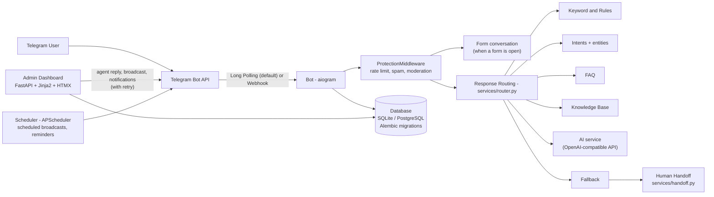

# Architecture



In polling mode the bot process (`python -m app.bot.main`) also runs the scheduler. In webhook mode
(`BOT_MODE=webhook`) the dashboard process receives the updates on `/telegram/webhook` and runs the scheduler.

## Response routing

```
User message
  -> ProtectionMiddleware (too fast / spam / blocked words -> stop)
  -> Command (/start, /help, /menu, /cancel, custom commands)
  -> Agent handling the conversation? -> store the message only, the agent answers
  -> Form open? -> next form step (Name -> Phone -> Email -> Request -> Confirmation)
  -> Keyword / Rule -> Intent (+ entities) -> FAQ -> Knowledge Base (+ AI) -> AI -> Fallback
  -> Fallback buttons: Rephrase / Main Menu / Human Support -> agent queue
```

## Layers

| Layer | Folder | Notes |
|---|---|---|
| Bot | `app/bot/` | Handlers only talk to Telegram and call services. `runtime.py` builds the bot for polling and webhook |
| Business logic | `app/services/` | Routing, rules, intents, forms, validation, handoff, AI, broadcast, notifications, stats, reports, logs, masking, moderation. No Telegram code except `telegram.py`, so it is easy to test |
| Data | `app/models.py`, `app/db.py`, `migrations/` | 16 ERD models plus `UnknownQuestion`; Alembic migrations run on start |
| Admin | `app/web/` | Server-rendered pages; HTMX updates parts of a page without a full reload. `deps.py` holds login, permissions and CSRF |
| Tools | `scripts/` | Backup and restore, copy to another database, answer-quality evaluation |

## Security

| Topic | How |
|---|---|
| Secrets | `.env` only (bot token, AI key, session secret, first admin password); never in the database or git |
| Admin passwords | scrypt hash with a random salt (`services/auth.py`) |
| Sessions | signed cookie, auto logout after `SESSION_TIMEOUT_MINUTES`, lockout after 5 failed logins |
| CSRF | a per-session token on every POST and DELETE (HTMX header or hidden form field) |
| Permissions | each route requires one of `view, create, edit, delete, reply, broadcast, train, report`; buttons are hidden when the role lacks it |
| Masking | roles without `reply` see masked names, usernames, phones and emails (pages, timeline, preview); contacts are never stored in question statistics |
| Audit | every admin change is an Audit log; bot errors are Error logs with the traceback |
| Webhook | Telegram's secret token header is checked on every update |
| Abuse | rate limit, repeated-message and link spam detection (auto-suspend after 3 strikes), blocked words |

## Rules of thumb

- Keep secrets in `.env`, never in code.
- Put logic in `services/`, keep handlers and routes thin.
- Every new feature gets at least one test in `tests/`.
- Change a model? Run `alembic revision --autogenerate -m "what changed"` and commit the migration.
